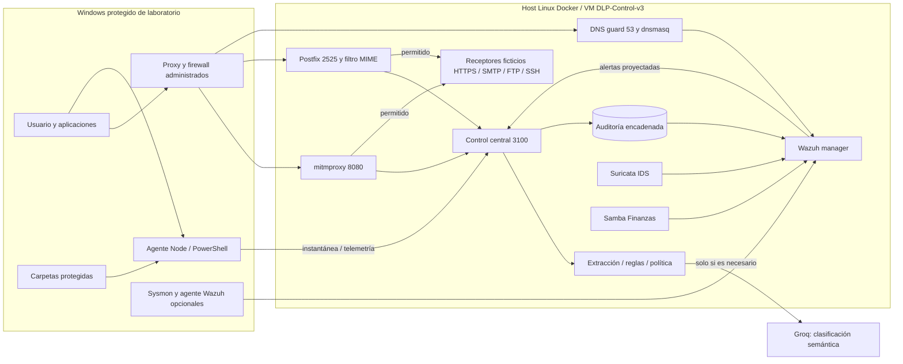
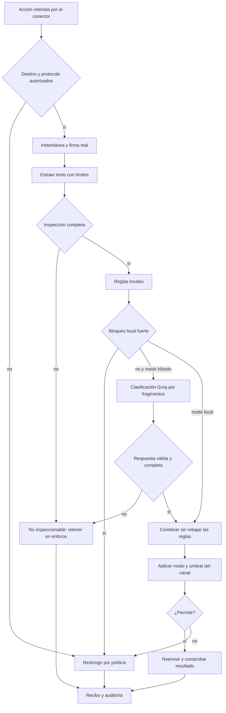

# Arquitectura del laboratorio DLP administrado

Versión 3. Octubre de 2026. Este documento describe la implementación actual; los PDF de portal y endpoint anteriores son antecedentes históricos.

## Objetivo y alcance

Clasificar información sensible y evaluar transferencias controladas, documentando permitido, detectado, alerta o bloqueado y los errores FP/FN. La clasificación es independiente de la detección de malware. El alcance combina agente Windows y puntos de control obligatorios por canal; no existe un único proceso que intercepte universalmente toda operación del sistema.

## Topología

El despliegue final de esta computadora usa DLP-Control-WSL sobre WSL2, con acceso desde Windows a control 3100, proxy 8080, SMTP 2525 y Wazuh 1514/1515. El resolver publica 5300/UDP hacia 53 del contenedor para no interferir con el DNS del sistema Linux. La alternativa VirtualBox añade SSH de administración en 2222 y se conserva apagada: presentó pausas con el backend Hyper-V de este anfitrión. Para incorporar otras VM se prepara una interfaz privada y se limitan puertos por origen. Un cliente que use DNS del sistema necesita el servicio en 53 de la IP privada del gateway; el puerto 5300 sirve para pruebas explícitas del anfitrión.

Docker mantiene el cliente y receptores en `172.30.50.0/24`, una red interna. El cliente solo puede salir por proxy, SMTP y DNS autorizados. FTP/SSH tienen excepciones explícitas de laboratorio; de lo contrario se restringen por canal. Los servidores publicados utilizan una red adicional de administración; proxy y control tienen salida externa necesaria. Los receptores no contienen reglas DLP propias, de modo que su aceptación/ausencia sirve como evidencia independiente.

## Componentes y responsabilidades

| Componente | Función | Ubicación |
| --- | --- | --- |
| Agente | Inventario, cambios, copias observadas y operaciones mediadas | endpoint/runtime.js |
| Sensor | Portapapeles, impresión y metadatos de eventos Sysmon disponibles | endpoint/windows/Sensor.ps1 |
| Motor | Extracción limitada en worker, reglas y clasificación híbrida | lib/inspection.js |
| Groq | Clasifica el significado del texto extraído mediante esquema cerrado | lib/semantic.js |
| Central | Destinos, modos, autenticación por rol, decisión y recibo | control/server.js |
| Proxy | Retiene cuerpo HTTP, decodifica y consulta antes de reenviar | integrations/proxy_addon.py |
| SMTP | Decodifica MIME, consulta y releva solo si se permite | integrations/mail_filter.py |
| DNS | Restringe dominio/tipo/longitud/frecuencia antes de resolver | integrations/dns_guard.py |
| SIEM | Correlaciona registros, procesos y firmas de red | deploy/wazuh/ |

El administrador configura políticas; el usuario produce las acciones de prueba; el evaluador determina la verdad de referencia y comprueba efectos. Son roles funcionales del laboratorio. La consola separa credenciales administrativas, de inspección y de telemetría; no implementa un directorio corporativo multiusuario. Wazuh consume siem.jsonl, una proyección escalar de la auditoría compatible con su decoder JSON. La auditoría completa mantiene su cadena independiente. Suricata emite únicamente alertas EVE para evitar estadísticas con cientos de campos y datos innecesarios.

## Flujo de decisión

Una decisión de bloqueo no prueba su ejecución. El control emite un ticket temporal; el conector remite cancelado, liberado, respuesta del destino o fallido. La evidencia externa se comprueba en las pruebas mediante bytes/hashes del receptor. Un evento Sysmon o una copia detectada después de escritura se registra como observación, sin prevención acreditada.

Reglas por defecto: 0 permite, 1-2 alerta y permite, 3 o más bloquea en enforce. En audit se detecta y permite; en alert se alerta y permite. Los puntos no son probabilidades. La política central puede denegar aunque el agente tenga un modo local más permisivo. Un resultado público del LLM no anula un indicador fuerte local.

## Clasificación semántica y tratamiento de fallos

El LLM recibe texto extraído, no ejecuta programas ni abre archivos en la PC. El documento se delimita como entrada no confiable; las instrucciones dentro del documento no tienen autoridad. La salida contiene solo clasificación y códigos permitidos. Las pruebas incluyen instrucciones maliciosas y salidas inválidas; estas defensas no demuestran inmunidad universal a prompt injection.

Clases: PUBLICO, INTERNO, CONFIDENCIAL, RESTRINGIDO y NO_DETERMINADO. El proveedor usa un esquema JSON estricto; el servidor valida otra vez propiedades y valores. Hasta 48 000 caracteres, fragmentos de 6 000 con solapamiento de 256, máximo nueve, dos consultas concurrentes y un presupuesto total de 45 segundos. La caché de 30 minutos almacena hash y resultado sin texto. Los límites de extracción del worker son distintos de los límites semánticos: superar estos últimos retiene la salida, aunque se haya extraído texto.

Clave ausente, 429, error de red, ambigüedad o salida inválida implican clasificación pendiente. En enforce no se envía el documento. El usuario puede demostrar únicamente reglas con modo off; debe indicar ese modo al reportar métricas. Groq procesa externamente el texto enviado: utilizar datos ficticios en esta fase.

## Escenarios y validación

| CU | Actor y acción | Resultado que se debe comprobar |
| --- | --- | --- |
| 01 | Usuario copia a USB | Mediado: público con mismo hash, privado ausente. Nativo: verificar política y dispositivo físico. |
| 02 | Copia Finanzas a escritorio observado | Alerta con hash coincidente después de escritura; evento Samba acredita lectura, no destino final. |
| 03 | Envía XLSX adjunto por SMTP | Público aceptado, DNI/tarjeta rechazado antes de relevo; revisar receptor. |
| 04 | Pega datos en cuerpo/asunto | Decodificar MIME y verificar 550 para sensible, 250 para permitido, 451 si falla motor. |
| 05 | Sube documento HTTPS | 403 antes de receptor; un público llega. Salida directa sin proxy denegada cuando firewall activo. |
| 06 | Pega datos en formulario público | Examinar texto y parámetros; no almacenar consultas completas en auditoría. |
| 07 | Sincroniza con rclone | Backend WebDAV real a través de HTTPS; público llega, privado recibe 403. |
| 08 | Abre SCP/SFTP | Servicio SSH operativo en control negativo, cliente restringido sin conexión; no inferir contenido cifrado. |
| 09 | Envía FTP claro | IDS genera firma sobre flujo visible; si se permite la excepción, el receptor recibe y no se reclama prevención. |
| 10 | Usa DNS como canal | Resolver rechaza etiqueta/dominio/tipo no autorizado; frecuencia produce alerta. No hace falta enviar datos reales. |
| 11 | Envía ZIP/7z/GPG cifrado | Retener por no inspección; no clasificarlo falsamente como información sensible reconocida. |
| 12 | Renombra Office, codifica o trocea | Firma real y base64 se analizan; Content-Range/fragmentos no inspeccionables se retienen. |

Las pruebas automatizadas emplean servicios reales donde se indica, dobles explícitos donde corresponde y únicamente muestras ficticias. USB físico, instalación del agente Wazuh/Sysmon en otro Windows, activación de políticas administrativas y sitios públicos reales requieren validación en el equipo destino; no quedan acreditados por compilar el código.

## Evaluación

Mantener dos matrices: detección de sensibilidad y prevención de la salida. Para cada documento fijar una etiqueta de referencia antes de ejecutar, registrar formato/tamaño/canal/modo, clasificación, reglas, estado semántico, decisión, resultado y evidencia. No contar como verdadero positivo de clasificación un bloqueo por clave ausente o formato desconocido.

Precisión = TP/(TP+FP); recall = TP/(TP+FN). También medir falsos bloqueos públicos, proporción de no inspeccionables, errores, latencia y cobertura de canales. La evaluación con Groq requiere una clave real y un conjunto independiente; los resultados de desarrollo con respuestas simuladas solo verifican el contrato de integración. Separar claramente las métricas históricas del portal.

## Operación y límites

La protección del Windows completo requiere configurar carpetas, instalar los sensores necesarios, forzar salida y probar bypass por aplicación. El agente funciona con los permisos de su sesión. No contiene driver minifilter, OCR, descifrado ni agente resistente a administradores. Las cargas parciales se restringen; no se promete recomponer fragmentos repartidos entre protocolos o sesiones. Las operaciones nativas de archivo son observadas después de escritura.

Los scripts administrativos empiezan en Plan. Apply se reserva a la VM Windows del laboratorio y conserva respaldo. Restore retira cambios propios cuando puede identificar su estado. No se ejecutaron automáticamente en el anfitrión. Las credenciales y claves privadas nunca se versionan. Los registros proyectan metadatos; el hash no anonimiza documentos de baja entropía ni constituye firma digital.

## Referencias técnicas

- Groq. Structured outputs: https://console.groq.com/docs/structured-outputs
- Groq. Your data: https://console.groq.com/docs/your-data
- mitmproxy. Event hooks: https://docs.mitmproxy.org/stable/api/events.html
- Postfix. Before-queue content filter: https://www.postfix.org/SMTPD_PROXY_README.html
- Wazuh. Docker deployment: https://documentation.wazuh.com/current/deployment-options/docker/wazuh-container.html
- Microsoft. Sysmon: https://learn.microsoft.com/en-us/sysinternals/downloads/sysmon
- Debian. Suricata packages: https://packages.debian.org/search?exact=1&keywords=suricata&searchon=names&section=all&suite=all
