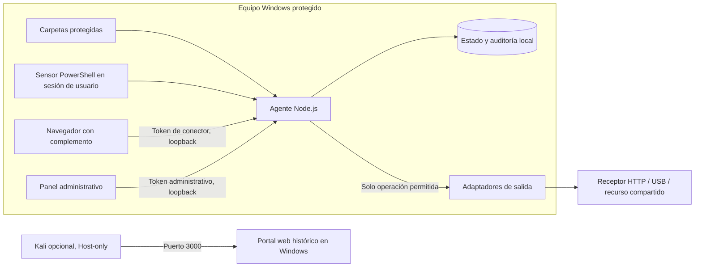
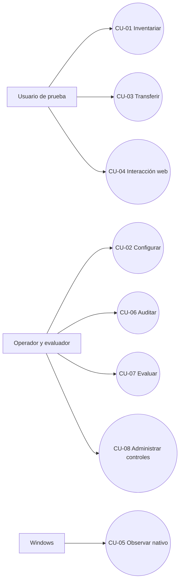
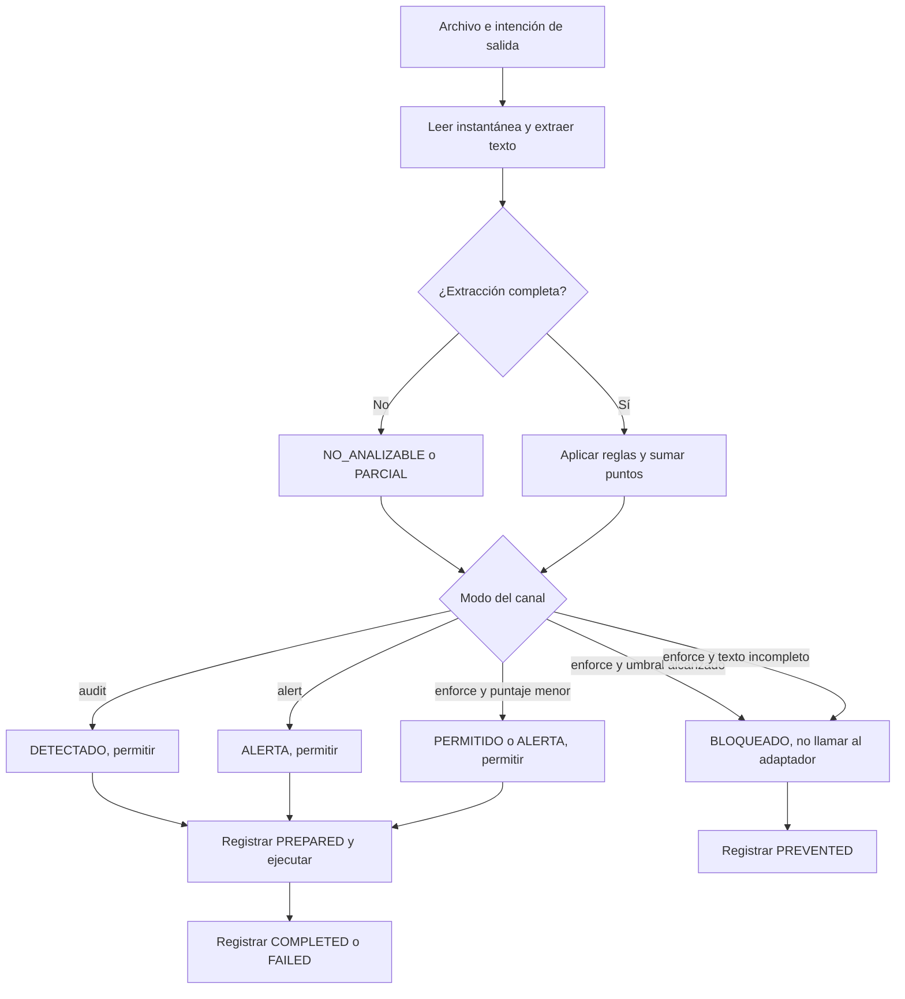

# Arquitectura y casos de uso del DLP de endpoint

Documento técnico de la versión 2.0.0. La entrega académica maquetada está en [el informe PDF](../output/pdf/Informe_DLP_Endpoint.pdf). Todos los ejemplos usan información ficticia.

## Qué resuelve la consigna

El motor clasifica documentos locales según once reglas explicables, observa cambios en carpetas elegidas y decide transferencias controladas. El panel muestra cuatro resultados que tienen efectos distintos:

| Resultado | Significado observable |
| --- | --- |
| PERMITIDO | Se autoriza el camino mediado; un recibo posterior demuestra si llegó al destino. |
| DETECTADO | Una regla coincidió en modo `audit`, o el vigilante halló contenido. La mera detección no detiene una copia. |
| ALERTA | Se registra la coincidencia de bajo puntaje o el modo `alert`; la operación puede continuar. |
| BLOQUEADO | El agente decide antes del adaptador, o el conector retiene una interacción soportada del navegador. |
| NO_ANALIZABLE / PARCIAL | No se obtuvo todo el texto; `enforce` restringe la operación por incertidumbre, sin afirmar detección sensible. |
| ERROR | Hubo un fallo de ejecución. No se convierte en una transferencia exitosa ni en detección. |

Los canales reales del equipo quedan en capas: operaciones mediadas por el agente; interacciones DOM soportadas por el complemento; observación nativa posterior al hecho; controles generales de Windows activados por separado. Esta distinción es esencial para explicar qué ocurrió en cada experimento.

## Arquitectura de red

El panel y la API escuchan en `127.0.0.1:3001`. El portal heredado escucha en `0.0.0.0:3000` para Kali sobre una red Host-only. Los receptores de demostración HTTP y web escuchan por defecto en `127.0.0.1:4100` y `127.0.0.1:4200`; su exposición de red requiere una configuración explícita. Kali no reemplaza al Windows protegido.

## Componentes

| Componente | Responsabilidad y límite |
| --- | --- |
| `endpoint/runtime.js` | Escaneo, vigilancia, instantánea del archivo, política, transferencia y recibos. Relee antes de enviar. |
| `lib/extract-worker.js` y `lib/inspection.js` | Extracción acotada TXT, CSV, JSON, PDF, DOCX, XLSX y texto soportado. No OCR ni descifrado. |
| `lib/classifier.js` | Once reglas y puntaje. Una coincidencia por regla, no probabilidad. |
| `lib/policy.js` | Modos `audit`, `alert`, `enforce` por canal y umbral de bloqueo. |
| `endpoint/windows/Sensor.ps1` | Sesión interactiva, bandeja, unidades, impresoras, portapapeles y trabajos externos visibles. La observación llega después del evento. |
| `extension/` | Inspección de selección manual, texto pegado y archivos arrastrados en páginas cubiertas. Depende de estar instalado y habilitado. |
| `endpoint/server.js` y `endpoint/ui/` | API local autenticada y panel. Tokens de administración y navegador separados. |
| `lib/audit.js` | Registro JSONL encadenado por SHA-256. Detecta alteraciones inconsistentes, sin firma digital. |
| `endpoint/windows/System-Controls.ps1` | Políticas generales opcionales para USB, SMB e impresión; bloquean el canal completo. |

La lectura para transferir usa una instantánea inmutable. Se clasifica esa instantánea y se entregan esos mismos bytes al adaptador; el inventario previo no autoriza una operación posterior. En una denegación se registra `PREVENTED` antes del adaptador. En una autorización se registra `PREPARED` y luego `COMPLETED` o `FAILED`.

## Casos de uso

| Caso | Precondición, camino principal y excepción |
| --- | --- |
| CU-01 Inventariar | Una carpeta configurada es accesible. El agente extrae, clasifica y registra hash/estado. Si hay límite, archivo inaccesible o formato desconocido, lo declara. Una creación nueva dispara un escaneo. |
| CU-02 Configurar | Operador con token administrativo. Valida raíces, modos y destinos. El token del navegador no permite cambiar políticas. |
| CU-03 Transferir | Selecciona archivo inventariado y destino. Se relee, clasifica y decide. Una denegación no invoca el adaptador; una autorización compara efecto y recibo. |
| CU-04 Interacción web | Complemento habilitado en la página. Retiene, inspecciona, libera o cancela selección, pegado o arrastre soportados. Un ticket de decisión no basta para demostrar que el destino recibió datos. |
| CU-05 Observar nativo | Sensor disponible. Registra texto o lista de archivos en el portapapeles después de copiar; registra metadatos visibles de impresión. La limpieza opcional se marca como reactiva. |
| CU-06 Auditar | Consulta decisiones y resultados, exporta CSV y verifica cadena. Si la cadena está alterada, el agente impide operaciones que necesitan registrar antes. |
| CU-07 Evaluar | Ejecuta casos ficticios con etiquetas de referencia independientes del puntaje. Contrasta archivos/recibos/hashes y calcula VP, FP, VN, FN por detección y prevención. |
| CU-08 Administrar | Consulta `Plan` sin cambios. Solo si decide aplicar, instala inicio del usuario o controles globales con respaldo; restaura posteriormente. |

## Flujo de decisión

El puntaje cero en extracción incompleta no implica archivo público. `audit` y `alert` mantienen el carácter permitido de la operación aunque se recomiende revisar. Para el navegador se registra primero la decisión y después un reporte del conector; el ensayo además consulta un destino independiente para comprobar recepción o ausencia de bytes.

## Escenarios reproducibles y tipo de evidencia

| Escenario | Efecto verificado | Lo que todavía no demuestra |
| --- | --- | --- |
| USB mediado inicial | Escritura de público y ausencia de sensible en directorio de laboratorio. | USB físico o bloqueo de copiar con Explorador. |
| Red mediada inicial | Escritura de público y ausencia de sensible en directorio de laboratorio. | Sesión SMB real. |
| HTTP mediado | Receptor loopback recibe público exacto y no sensible; hashes contrastados. | Inspección de todas las conexiones de red del equipo. |
| Portapapeles e impresión multicanal | Doble de prueba comprueba que no se llama al adaptador tras bloqueo. | Dispositivo nativo en esa batería. |
| Impresión nativa adicional | Windows Print to PDF produjo un PDF público; sensible bloqueado antes del controlador. | Cualquier trabajo de impresión de otras aplicaciones. |
| Selección, pegado y arrastre web | Ocho escenarios E2E ejecutados en Chromium 151 con receptor independiente, control negativo y agente desconectado. | Todo sitio, Firefox o portapapeles físico; pegado y arrastre usaron eventos DOM sintéticos. |
| Controles generales | Script `Plan` inspecciona estado sin cambiarlo. | Eficacia de `Apply` en un dispositivo físico mientras no se aplique. |

Los datos de `evaluacion/casos-endpoint.json` contienen 27 documentos ficticios. Se repiten cinco veces para 135 operaciones. En la lectura integral por canal: detección VP 13, FP 3, VN 8, FN 3; prevención VP 13, FP 3, VN 8, FN 3. Los conteos iguales no implican los mismos casos: el cierre ante extracción incompleta cambia qué caso se restringe. Precisión y recall integrales: 81,25 % cada una. El conjunto se creó durante desarrollo, por lo que no estima rendimiento con documentos inéditos. Consultar `output/evaluacion/resultado-endpoint.json` para cada operación, sus recibos y las métricas completas.

## Límites y siguientes pruebas físicas

El sistema no instala un filtro kernel, no puede asegurar bloqueo selectivo de todas las aplicaciones ni detecta malware. La información privada puede expresarse sin los patrones previstos. Los PDF escaneados necesitan OCR, ausente aquí. Una extensión puede deshabilitarse y algunas aplicaciones web no aceptarán los eventos reemitidos.

Para USB real se requiere una unidad propia identificada por Windows como extraíble y un destino `lab=false`. Para SMB se requiere un recurso UNC autorizado y comprobar archivos desde el servidor. El bloqueo general de USB/SMB/impresión requiere permisos de administrador, una decisión explícita de aplicar y posterior verificación externa. La simple existencia de una política o de una entrada en la auditoría no sustituye el efecto en el destino.

## Fuentes técnicas

- [Microsoft Learn: Endpoint DLP](https://learn.microsoft.com/en-us/purview/endpoint-dlp-learn-about), para distinguir actividades de endpoint.
- [Microsoft Learn: file system filter drivers](https://learn.microsoft.com/en-us/windows-hardware/drivers/ifs/about-file-system-filter-drivers), como referencia de un nivel de integración que este prototipo no implementa.
- [Microsoft Learn: removable storage policy](https://learn.microsoft.com/en-us/windows/client-management/mdm/policy-csp-admx-removablestorage), para el control general de escritura.
- [Chrome for Developers: content scripts](https://developer.chrome.com/docs/extensions/develop/concepts/content-scripts), para el alcance del conector de navegador.
