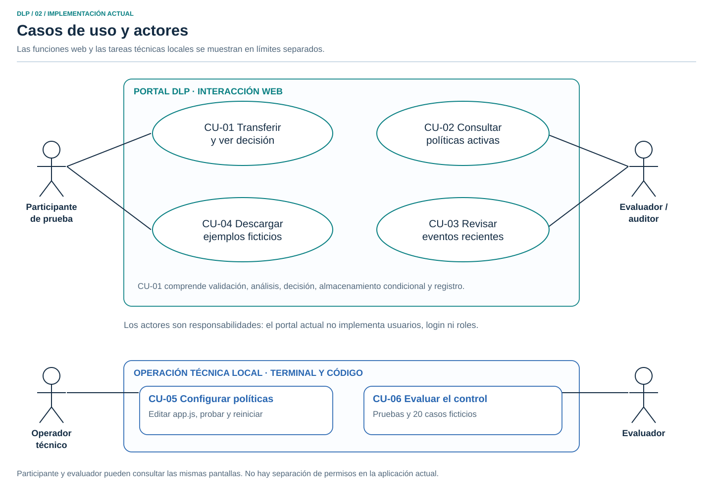
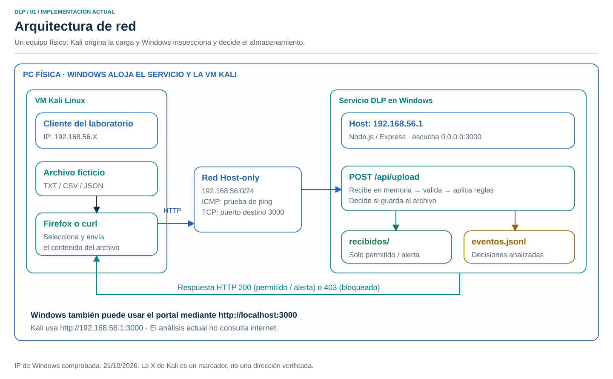
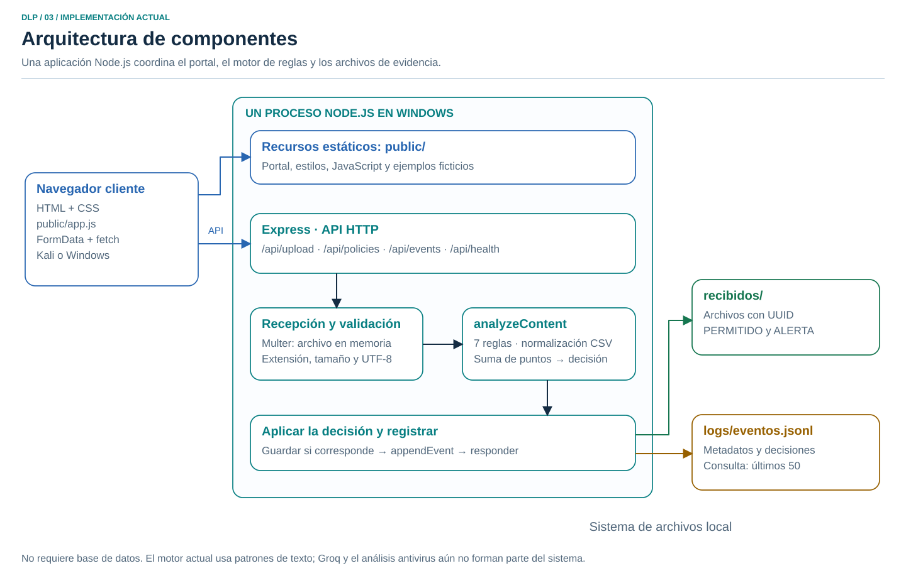
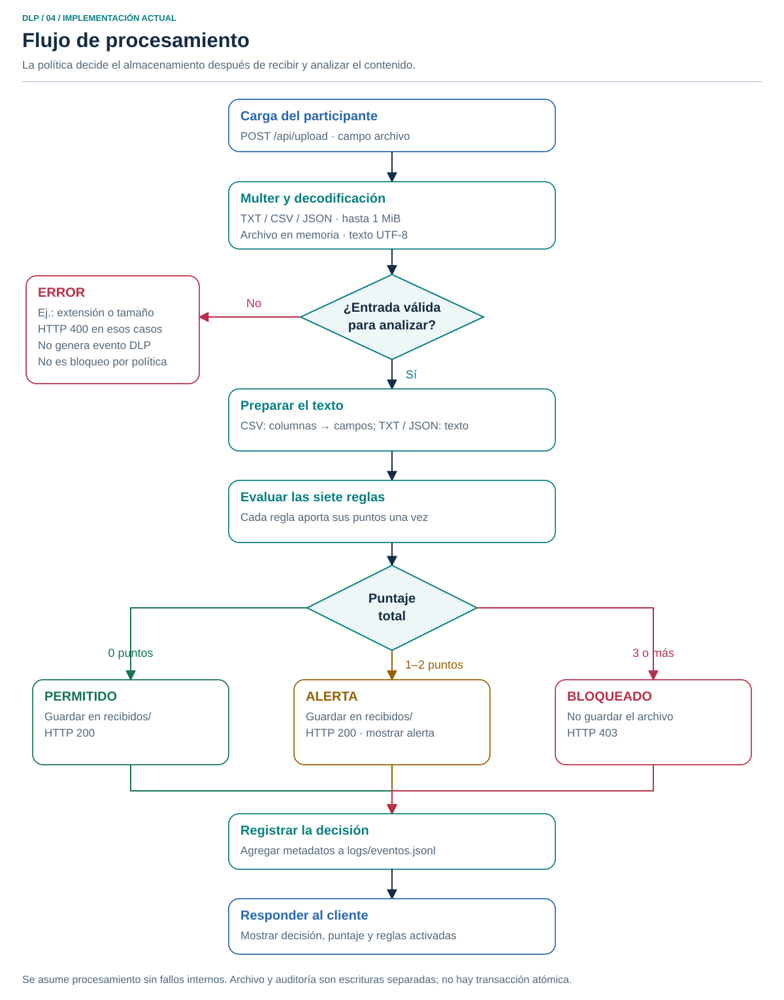
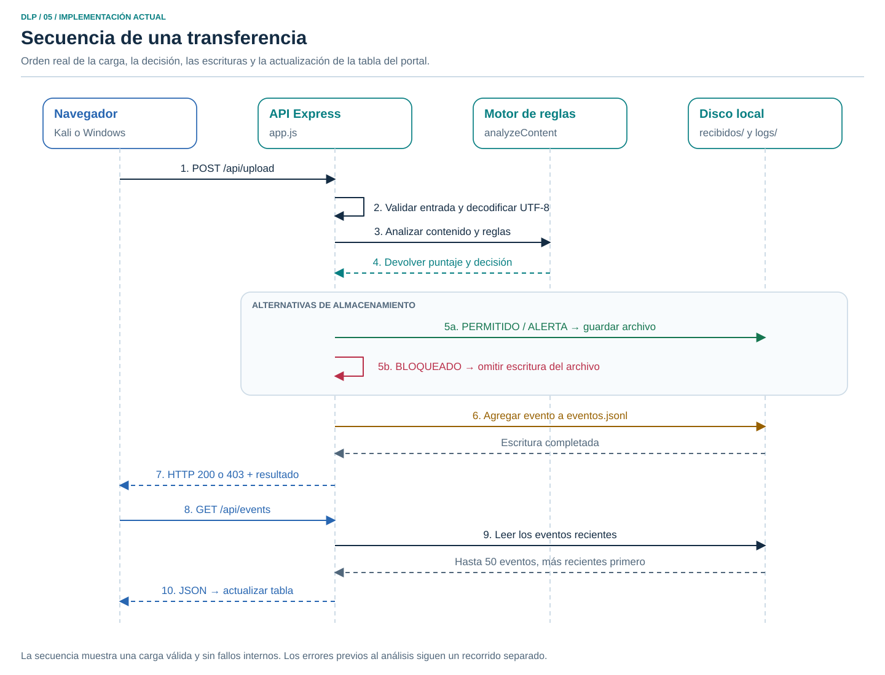

# Laboratorio DLP: casos de uso y arquitectura

Documento de la implementación actual, revisado el 21 de octubre de 2026. Basado en `app.js`, `public/`, las pruebas y la evaluación del repositorio. Groq todavía no está integrado.

Versión para lectura e impresión: [informe técnico en PDF](../output/pdf/Informe_tecnico_DLP.pdf).

Para ver los diagramas juntos sin instalar herramientas, abre [la guía visual HTML](guia-visual.html). Los gráficos también están en [SVG](diagramas/) y su generador editable es [generar-diagramas.js](generar-diagramas.js).

## 1. De qué trata el proyecto

El proyecto implementa un control de detección y prevención de fuga de información en un canal de carga de archivos. Un participante intenta transferir archivos ficticios desde Kali hacia un servicio instalado en Windows. Antes de guardarlos en la carpeta de destino, el servicio inspecciona el contenido, identifica coincidencias con sus políticas y responde con una decisión explicable.

El objetivo experimental es comprobar qué transferencias son permitidas, detectadas mediante una alerta o bloqueadas; además, medir falsos positivos y falsos negativos respecto de una clasificación de referencia definida por el evaluador.

**Qué significa bloquear aquí:** los bytes del archivo ya llegaron a la memoria del servicio DLP, pero este no los guarda en `recibidos/`. No se está cortando una conexión antes de recibir los datos ni vigilando todas las salidas de la computadora. El servidor actúa a la vez como punto de control y receptor del canal simulado.

El escenario usa una sola computadora física: Windows ejecuta el servicio y aloja, mediante VirtualBox, una máquina virtual Kali. También es posible probar todo desde el navegador de Windows sin iniciar Kali.

## 2. Actores y responsabilidades

| Actor lógico | Responsabilidad | Forma de interacción |
| --- | --- | --- |
| Participante de prueba | Seleccionar archivos ficticios, intentar transferirlos y observar la decisión | Firefox en Kali, navegador en Windows o `curl` |
| Evaluador / auditor | Consultar políticas y eventos, comparar resultados con la clasificación real y revisar evidencias | Portal, archivos de auditoría y evaluación por terminal |
| Operador técnico | Instalar y arrancar el servicio, editar las reglas y reiniciar el proceso | Terminal y edición de `app.js` en Windows |

Estos actores describen funciones de las personas. El sistema actual no tiene inicio de sesión ni permisos diferenciados; una misma persona puede cumplir los tres papeles. Los endpoints accesibles en la red no distinguen entre participante y auditor.

## 3. Casos de uso

### CU-01. Transferir un archivo y conocer la decisión

| Campo | Descripción |
| --- | --- |
| Actor principal | Participante de prueba |
| Objetivo | Enviar un archivo al canal controlado y conocer si se almacena o se bloquea |
| Precondiciones | Servicio encendido y accesible; archivo ficticio disponible en el equipo del cliente |
| Disparador | Pulsar «Analizar y transferir» o enviar una carga a `POST /api/upload` |
| Entrada | Un archivo en el campo multipart `archivo`: TXT, CSV o JSON, hasta 1 MiB (1.048.576 bytes), texto UTF-8 |
| Salida | Decisión, puntaje, reglas coincidentes, mensaje y metadatos del evento |
| Resultado | PERMITIDO o ALERTA: archivo guardado y evento registrado; BLOQUEADO: evento registrado y archivo sin guardar |

Flujo principal:

1. El participante selecciona el archivo en el navegador.
2. El navegador envía el contenido al endpoint de carga.
3. Multer comprueba extensión y límites, y mantiene el archivo en memoria.
4. El servidor comprueba que se recibió un archivo y decodifica UTF-8.
5. `analyzeContent` aplica las reglas. En CSV se añade una representación de columnas y valores; en TXT y JSON se examina el texto. El JSON no se interpreta con `JSON.parse` para clasificarlo.
6. Se suman una vez los puntos de cada regla coincidente y se obtiene la decisión.
7. Si corresponde permitir la transferencia, se guarda el archivo con un identificador UUID y un nombre normalizado.
8. Se agrega un evento a `logs/eventos.jsonl`.
9. El servidor responde HTTP 200 para PERMITIDO/ALERTA o HTTP 403 para BLOQUEADO. El portal muestra la decisión y vuelve a consultar los eventos.

Alternativas: falta de archivo, extensión no admitida, tamaño excesivo o texto UTF-8 inválido producen ERROR, normalmente HTTP 400 para esos casos. Un fallo interno puede producir HTTP 500. **Las solicitudes rechazadas antes de completar el análisis no se incorporan al archivo de eventos DLP actual.** No deben presentarse como bloqueos por contenido sensible.

### CU-02. Consultar las políticas activas

Actor: participante o evaluador. Con el servicio disponible, el portal solicita `GET /api/policies` al cargar la página y muestra identificador, nombre, descripción y puntos de las siete reglas. Es una consulta: la pantalla no permite editar políticas. Si la consulta falla, el portal muestra un error de carga.

### CU-03. Revisar eventos recientes

Actor: evaluador o participante. El portal solicita `GET /api/events` al abrirse, después de una carga y al pulsar «Actualizar». Muestra hasta 50 eventos, los más recientes primero, con hora, archivo, reglas, puntaje y decisión. La hora de pantalla se formatea en el navegador; el registro original usa una fecha ISO en UTC. Si no hay registros, se muestra una tabla vacía. Esta consulta no descarga los archivos recibidos.

### CU-04. Obtener archivos ficticios de ejemplo

Actor: participante. Desde los enlaces del portal descarga un JSON público, un JSON confidencial o un texto privado sin etiqueta, alojados en `public/ejemplos/`. Luego puede seleccionarlos para CU-01. La descarga del ejemplo no equivale a una carga analizada y no genera un evento DLP.

### CU-05. Configurar y activar una política

Actor: operador técnico. Fuera del portal, edita `rules` o los umbrales en `analyzeContent`, dentro de `app.js`. Comprueba el cambio mediante pruebas y reinicia el proceso para activarlo. La postcondición es que las siguientes cargas utilicen las nuevas reglas. No hay editor web de políticas, versionado automático de cambios ni auditoría de administración.

### CU-06. Evaluar el comportamiento del control

Actor: evaluador, mediante terminal. Ejecuta `npm.cmd test` para las pruebas funcionales o `npm.cmd run evaluate` para los 20 casos ficticios. Cada herramienta utiliza una instancia HTTP local y carpetas temporales; no llena el historial del portal principal. La evaluación compara la decisión con las etiquetas de `evaluacion/casos.json`, calcula las matrices de detección y prevención, y comprueba el registro de eventos y la cantidad de archivos almacenados. El resultado sirve como evidencia para ese conjunto, no como una garantía sobre cualquier documento.

## 4. Arquitectura de red

| Elemento | Configuración y función |
| --- | --- |
| PC física Windows | Aloja VirtualBox y el servicio Node.js / Express |
| VM Kali Linux | Origina las cargas de prueba y abre el portal; no necesita ejecutar el servidor DLP |
| Red Host-only | Canal privado de laboratorio entre Kali y el host Windows |
| IPv4 de Windows | `192.168.56.1`, presente en el adaptador Ethernet 4 al ejecutar `ipconfig` el 21/10/2026 |
| Subred del adaptador | `192.168.56.0/24`, con máscara `255.255.255.0` |
| IPv4 de Kali | `192.168.56.X`: marcador; la dirección exacta debe comprobarse en Kali con `ip -4 addr` |
| Comunicación de aplicación | HTTP sobre TCP, destino `192.168.56.1:3000`; respuesta al puerto de origen del cliente |
| Prueba de conectividad | ICMP mediante `ping`; su éxito no comprueba por sí solo que TCP 3000 esté disponible |
| Acceso desde Windows | `http://localhost:3000` |
| Escucha del proceso | Por defecto `0.0.0.0:3000`: todas las interfaces IPv4, no solo Host-only; puede cambiar con `HOST` y `PORT` |

La conexión Host-only es el diseño empleado en las capturas del laboratorio. La IP de Windows se comprobó en esta revisión; no se verificaron en vivo la IP de Kali, el estado de su VM ni las reglas del firewall. Un adaptador NAT adicional para internet es opcional y no participa en la inspección actual. El análisis por reglas funciona sin consultar servicios de IA ni otras APIs externas, una vez instaladas las dependencias.

En Kali, `localhost` identifica a Kali. Por eso debe utilizarse la dirección del host Windows. El prototipo usa HTTP sin TLS; el diagrama representa una red de laboratorio y no un despliegue público.

## 5. Arquitectura de componentes

| Componente | Archivo o ubicación | Responsabilidad |
| --- | --- | --- |
| Portal | `public/index.html`, `public/styles.css` | Formulario de carga, resultados, tarjetas de políticas y tabla de eventos |
| Cliente JavaScript | `public/app.js` | Construir `FormData`, llamar a las APIs y mostrar las respuestas |
| Servidor HTTP | `app.js`, Express | Servir el portal, exponer endpoints y coordinar el procesamiento |
| Recepción y validación | Configuración de Multer y `TextDecoder` | Restringir extensión/tamaño y obtener texto UTF-8 en memoria |
| Motor de reglas | `rules`, `parseCsvRows`, `csvFieldsAsText`, `analyzeContent` | Detectar coincidencias y calcular puntaje y decisión |
| Almacenamiento | `safeFileName` y escritura en `recibidos/` | Guardar cargas permitidas o en alerta con un UUID |
| Auditoría | `appendEvent`, `readRecentEvents`, `logs/eventos.jsonl` | Agregar registros y consultar los 50 más recientes |
| Verificación | `test/app.test.js`, `evaluacion/evaluar.js` | Comprobar comportamiento y medir errores sobre casos ficticios |

Los componentes del servidor se encuentran en un único proceso Node.js. No son microservicios separados. El proyecto usa el sistema de archivos; no requiere una base de datos.

### Endpoints reales

| Método y ruta | Función | Respuesta habitual |
| --- | --- | --- |
| `GET /` | Entregar el portal y sus recursos estáticos | HTML, CSS y JavaScript |
| `GET /api/health` | Consultar el estado básico del servicio | HTTP 200 y JSON de estado |
| `GET /api/policies` | Listar reglas y puntos | HTTP 200 y arreglo JSON |
| `GET /api/events` | Listar hasta 50 eventos | HTTP 200 y arreglo JSON |
| `POST /api/upload` | Inspeccionar el archivo del campo `archivo` | HTTP 200, 403 o ERROR según el caso |

## 6. Flujo de procesamiento y decisiones

| Regla | Evidencia que busca | Puntos |
| --- | --- | ---: |
| DLP-001 | Campo `CLASIFICACION` con valor `CONFIDENCIAL`, admitiendo comillas como en JSON | 3 |
| DLP-002 | Campo `CLASIFICACION` con valor `RESTRINGIDO` | 5 |
| DLP-003 | Campo `CODIGO_ESTUDIANTE` con ocho dígitos; también columna CSV normalizada | 2 |
| DLP-004 | Campo `NOTA_FINAL` con patrón de un valor entre 0 y 20; también columna CSV normalizada | 2 |
| DLP-005 | Correo del dominio ficticio `universidad.edu.pe` | 1 |
| DLP-006 | Etiqueta `CONTRASEÑA_TEMPORAL:` o `CONTRASENA_TEMPORAL:` | 3 |
| DLP-007 | Coexistencia del patrón de estudiante/alumno con nombre y el patrón de nota/calificación final en el texto | 3 |

Las reglas son patrones; no validan la identidad del estudiante ni consultan un registro institucional. DLP-007 comprueba que sus dos patrones estén presentes en el contenido, sin garantizar que pertenezcan a la misma persona o frase. Cada regla aporta su puntaje una sola vez por archivo, aunque tenga varias coincidencias. El puntaje es una decisión de política, no un porcentaje de probabilidad.

| Puntaje total | Decisión | Archivo en destino | Evento de auditoría | HTTP |
| ---: | --- | --- | --- | ---: |
| 0 | PERMITIDO | Sí | Sí | 200 |
| 1–2 | ALERTA | Sí | Sí | 200 |
| 3 o más | BLOQUEADO | No | Sí | 403 |

Una ALERTA cuenta como detección, pero permite el almacenamiento. La interfaz muestra la alerta y el registro; no se envían correos ni notificaciones a un sistema externo.

### Tres ejemplos para explicar la decisión

| Entrada ficticia | Coincidencias | Puntaje | Resultado |
| --- | --- | ---: | --- |
| `HORARIO DE CLASES` | Ninguna | 0 | PERMITIDO |
| `Contacto: ana@universidad.edu.pe` | DLP-005 | 1 | ALERTA y archivo guardado |
| `{"codigo_estudiante":"20261234","nota_final":18}` | DLP-003 y DLP-004 | 4 | BLOQUEADO y archivo sin guardar |

## 7. Secuencia de una carga

El orden de escritura actual es relevante: primero se guarda el archivo si está permitido o en alerta, después se agrega el evento y finalmente se responde. No existe una transacción que haga atómicos archivo y auditoría. Si una escritura de auditoría falla después de guardar un archivo, puede devolverse un error con el archivo ya almacenado. Este comportamiento debe considerarse al interpretar fallos internos.

El evento contiene `id`, `timestamp`, `clientIp`, `file`, `storedName`, `size`, `score`, `matches` y `decision`. Cuando se bloquea, `storedName` es `null`. Se registra metainformación de la decisión; el evento no contiene una copia completa del documento.

## 8. Cómo demostrarlo y evaluarlo

1. En Windows, iniciar `npm.cmd start` y abrir el portal.
2. Desde Kali, abrir `http://192.168.56.1:3000` tras comprobar su conexión Host-only.
3. Cargar los ejemplos público, de alerta y confidencial. Comparar la decisión, el puntaje y las reglas.
4. Cargar el JSON confidencial y el texto privado sin etiqueta desde los ejemplos descargables.
5. Mostrar en Windows que `recibidos/` contiene solo cargas permitidas o en alerta y que el bloqueo figura en `logs/eventos.jsonl`.
6. Ejecutar `npm.cmd run evaluate` y explicar las dos matrices: detección considera positivo ALERTA/BLOQUEADO; prevención considera positivo solo BLOQUEADO.

La clasificación de referencia se define por el propósito y contenido de cada archivo en `evaluacion/casos.json`, antes de compararla con la decisión del motor. No se deduce del mismo puntaje que se está evaluando. Los falsos positivos son documentos públicos detectados o bloqueados indebidamente; los falsos negativos son documentos sensibles que no se detectan o no se bloquean, según la medición elegida. Las pruebas automatizadas se realizan localmente en Windows y no deben presentarse como 20 transferencias originadas en Kali.

## 9. Alcance actual y ampliaciones

El sistema actual inspecciona cargas de texto TXT, CSV y JSON de hasta 1 MiB. No analiza PDF, Word, Excel, imágenes, archivos comprimidos o ejecutables; tampoco realiza análisis antivirus, inspección de correo/USB u observación de otras páginas web. No tiene autenticación, cuarentena ni un flujo de aprobación manual. La clasificación depende de siete reglas y sus umbrales.

Groq sería una ampliación posterior para analizar contexto, con su propia configuración, política de envío de contenido y evaluación comparativa. Los diagramas de este documento describen el sistema previo a esa ampliación; no atribuyen al proyecto análisis mediante IA ni detección general de malware.

## 10. Guion breve de exposición

«Mi proyecto implementa un control DLP para un canal de transferencia de archivos. Windows aloja el servicio y Kali actúa como cliente dentro de una red Host-only. Cuando intento cargar un archivo, el servidor valida el formato, analiza el texto mediante reglas y suma los puntos. Con cero puntos permite, con uno o dos permite con alerta y con tres o más bloquea el almacenamiento. Los resultados analizados quedan registrados para auditoría. Comparo esas decisiones con archivos ficticios previamente clasificados para medir falsos positivos y negativos. El alcance actual es el portal de carga, y la integración contextual con un LLM es una ampliación futura».
