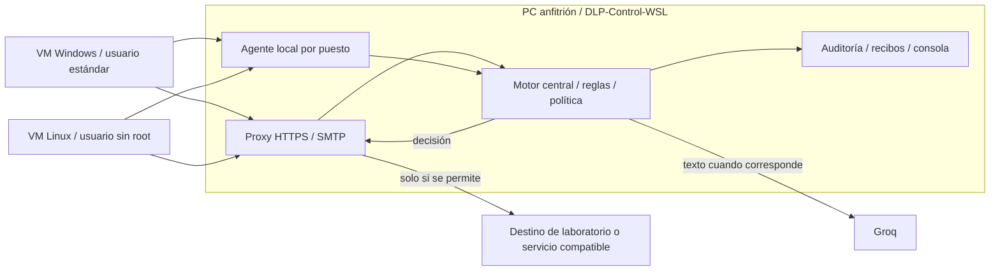

# DLP central con dos puestos de trabajo: preparación y exposición

Revisión del 5 de noviembre de 2026. Esta guía distingue código existente, topología propuesta y pruebas pendientes. No activa políticas, inicia VM ni cambia sus adaptadores.

## 1. Qué está unificado y qué puede inspeccionar

En la rama `fix/dlp-upload-recovery-empty-files`, `npm.cmd start` coordina central, proxy, SMTP, servicios Linux, agente local y receptores. Si DLP_CONTROL_URL apunta a otro equipo, el mismo lanzador consulta ese central y no inicia WSL local. Una instalación por puesto sigue siendo necesaria: un solo comando no convierte varios sistemas operativos en un único proceso ni aplica automáticamente sus controles de red.

El LLM recibe texto extraído de documentos que llegan al motor. No observa por sí solo toda la PC. En modo híbrido, una extracción completa sin bloqueo local fuerte puede consultar Groq; un documento ya bloqueado por reglas no necesita esa consulta. Vacíos válidos no consumen LLM. Extracción incompleta, formato desconocido o clasificador no disponible se retienen en enforce por falta de inspección, sin atribuir sensibilidad reconocida.

El inventario examina las carpetas configuradas con presupuesto y cola, y no todo el disco permanentemente. En clientes centrales, inventorySemantic habilitado consulta al servidor aunque el LLM local esté apagado y el cliente no tenga GROQ_API_KEY. La corrección de esa ruta tiene una prueba cliente/servidor con un doble explícito del clasificador; no acredita exactitud de Groq real.

Instalar una aplicación nueva de correo no la incorpora automáticamente. Para Gmail web/PWA o cualquier cliente se debe comprobar su implementación y ruta de salida. Una aplicación compatible con el proxy y su CA puede enviar tráfico inspeccionable. Thunderbird configurado con el SMTP del laboratorio usa el filtro de correo. Clientes que ignoran proxy, usan protocolos no soportados, pinning o cifrado de aplicación necesitan denegación del canal o integración específica. No se ofrece filtrado selectivo universal de WhatsApp/Discord. Sus reglas actuales restringen toda la red.

## 2. Topología propuesta con tus VM

Inventario de solo lectura realizado durante esta revisión:

- Anfitrión: interfaz Host-only 192.168.56.1/24.
- VM `Windos`: Windows 10 de 64 bits, apagada, adaptador 1 sin conexión.
- VM `kali-linux-2025.2-virtualbox-amd64`: apagada, adaptadores NAT y puente.

Las direcciones siguientes para clientes son propuestas; no se asignaron ni se comprobó que estén libres:

| Equipo | Papel | Dirección propuesta |
| --- | --- | --- |
| PC Windows + DLP-Control-WSL | Servidor y consola administrativa | 192.168.56.1 |
| VM Windos | Puesto de trabajo WIN-01 | 192.168.56.20/24 |
| VM Kali | Puesto de trabajo LIN-01 | 192.168.56.30/24 |



Para la fase de evaluación se propone una sola interfaz Host-only en cada cliente. Eliminar NAT/puente durante esa fase evita esas salidas alternativas a Internet. Descargar dependencias se hace durante la preparación, antes del aislamiento. No habilitar Internet Connection Sharing, encaminamiento o un proxy ajeno como ruta alternativa. Host-only permite comunicación entre las VM y el host: no restringe por sí solo todas las transferencias laterales entre puestos. Las reglas de cada cliente deben limitar los canales permitidos.

El Windows del anfitrión conserva su acceso habitual; las restricciones del puesto empresarial se prueban dentro de las VM. El uso de cuenta estándar es parte del alcance: no hay defensa acreditada contra un administrador que cambie adaptadores, políticas o software.

## 3. Pendiente antes de probar desde las VM

Los servicios Windows se prepararon para localhost. `127.0.0.1` dentro de una VM es esa VM. Cambiar solamente la IP en la extensión no publica el servidor.

Preparación requerida, todavía no aplicada en esta revisión:

1. Snapshot de cada VM; instalar dependencias y navegador/cliente de correo de prueba.
2. Asignar IP libre y Host-only; retirar NAT/puente para la evaluación y comprobar IPv4/IPv6 y rutas. No asignar al host como router genérico.
3. Publicar los conectores necesarios del WSL en la interfaz privada del anfitrión y limitar sus reglas de entrada a los clientes. Control TCP 3100, proxy TCP 8080 y SMTP TCP 2525. No exponerlos al Wi-Fi/LAN general. TCP portproxy no publica UDP; DNS necesita tratamiento independiente si se incluye ese caso.
4. Probar acceso desde cada VM. Esta publicación de WSL, firewall y adaptadores aún no se validó entre las tres máquinas.
5. Copiar solo la CA pública `datos-control/certs-public/mitmproxy-ca-cert.pem`. Configurar confianza/proxy en el navegador o almacén que use cada aplicación, sin desactivar la validación TLS.
6. Vincular el agente de cada puesto al central; la clave Groq y token ADMIN se quedan en el servidor.
7. Revisar Plan, aplicar en la VM Windows el perfil Protection.ps1 y auditarlo. Linux comparte los conectores de red, pero no tiene un equivalente nativo completo de esos controles PowerShell; requiere reglas/políticas Linux y validación propias. El firewall de `deploy/services/client-entry.sh` protege un contenedor de pruebas, no la VM Kali entera.
8. Ejecutar tanto controles positivos como negativos y comprobar el receptor. Si fallan, registrar el caso pendiente o el hueco; no declarar cobertura completa.

En cada VM, con el servidor ya publicado, una primera comprobación sin credenciales es:

```powershell
# VM Windows; solo lectura
Test-NetConnection 192.168.56.1 -Port 3100
Test-NetConnection 192.168.56.1 -Port 8080
curl.exe --max-time 5 http://192.168.56.1:3100/healthz
```

```bash
# VM Linux; solo lectura
curl --max-time 5 http://192.168.56.1:3100/healthz
```

Healthz no prueba autenticación, inspección HTTPS ni prevención. Para comprobar CA y proxy, tras copiarlos y configurar el acceso, se puede enviar una muestra ficticia al receptor HTTPS independiente:

```bash
curl --noproxy '' --proxy http://192.168.56.1:8080 --cacert ./mitmproxy-ca-cert.pem --max-time 60 -H 'Content-Type: text/plain' --data-binary @publico.txt https://sink.dlp.test:4201/upload
```

En PowerShell usar `curl.exe` y la ruta Windows real de la CA/muestra. El nombre sink.dlp.test se resuelve desde el proxy del laboratorio. Repetir con un archivo sensible, guardar la decisión y verificar presencia/ausencia en el receptor. Un código HTTP por sí solo no acredita que los bytes llegaron o no llegaron.

## 4. Instalación de los puestos y arranque diario

Instalar Node 24+ y Git, y usar la rama revisada hasta que se fusione:

```text
git clone --branch fix/dlp-upload-recovery-empty-files https://github.com/Brando-01/DLP.git
cd DLP
```

En el servidor, preparar un archivo de configuración para clientes:

```powershell
npm.cmd run endpoint:export -- http://192.168.56.1:3100
```

Esto genera .env.endpoint; no activa la publicación del servidor. Copiarlo de forma privada como `.env` en cada cliente, antes de setup. Contiene tokens de inspección y telemetría; no publicarlo ni mostrarlo en capturas. El HTTP de este ejemplo es una concesión al laboratorio Host-only aislado: los datos y tokens no quedan cifrados en ese tramo. Para una red corporativa o compartida se debe usar TLS con certificados válidos y credenciales por dispositivo. La exportación actual no constituye enrolamiento empresarial independiente por puesto.

En Windows cliente:

```powershell
npm.cmd ci
npm.cmd start
```

En Linux cliente:

```bash
npm ci
npm start
```

Cada cliente abre su propio panel en http://127.0.0.1:3001. Vincular la extensión con el token Navegador de ese agente, no con el token ADMIN ni con el de otro puesto. Configurar carpetas vigiladas con rutas propias del sistema. Al apuntar DLP_CONTROL_URL al servidor remoto, el cliente no instala otro WSL. Los sensores de portapapeles, impresoras y controles Windows no se ejecutan en Linux; el código portable y los conectores no equivalen a un agente nativo Linux completo.

El servidor también se inicia con `npm.cmd start`. Un comando por instalación es compatible con una arquitectura distribuida. Mantener la terminal abierta durante la prueba. Las restricciones administrativas se activan/restauran por separado y no desaparecen por cerrar el agente.

## 5. Casos principales para presentar

Conservar estos ocho casos originales como núcleo; no borrar los otros del repositorio:

| Caso | Situación empresarial | Qué se demuestra | Plataformas y condición |
| --- | --- | --- | --- |
| CU-05 | Subir un Word/Excel a una nube o conversor | Público llega; sensible se retiene; destino prohibido se distingue de sensibilidad | Windows y Linux, proxy obligatorio y CA; probar cada formato/sitio |
| CU-06 | Pegar datos de clientes en formulario web | Inspección del texto enviado y decisión previa | Ambos, carga HTTP compatible; probar pegado y envío efectivo |
| CU-03 | Enviar Excel adjunto por correo | MIME inspeccionado antes de relevo SMTP | Ambos, Thunderbird contra SMTP del laboratorio |
| CU-04 | Enviar datos privados en cuerpo/asunto | Bloqueo del contenido sin archivo adjunto | Ambos, mismo SMTP controlado |
| CU-02 | Copiar Finanzas al escritorio observado | Detectar y alertar después de la copia | Configurar ambas rutas; no afirmar prevención de esa copia |
| CU-01 | Copiar a USB | Decisión previa en transferencia mediada por el agente | Directorio de prueba identificado; USB físico y Explorador son pruebas separadas |
| CU-11 | Intentar enviar archivo cifrado | Retención por no poder inspeccionar | Canal cubierto; no contar como acierto semántico |
| CU-12 | Renombrar Office o codificar en base64 | Firma real, extracción y tratamiento de inspección incompleta | Ambos a través del motor; sin prometer recomposición universal |

CU-07 rclone queda como ampliación de subida HTTPS/WebDAV. CU-08 SSH/SFTP prueba restricción de canal cifrado. CU-09 FTP y CU-10 DNS quedan como anexos de monitorización/control de canal. Son útiles, pero no necesarios para una exposición centrada en documentos y correo.

Añadir dos pruebas transversales a los casos principales:

- **Contexto sin etiquetas:** un registro ficticio con persona y calificación/salario redactados en lenguaje natural, sin la palabra confidencial y sin que active un bloqueo fuerte local. Registrar semanticStatus COMPLETE/LLM-001 para atribuir la decisión al LLM. BYPASSED_LOCAL_BLOCK acredita reglas; un acierto no garantiza todos los documentos.
- **Bypass:** repetir la subida desde navegador sin extensión, curl sin proxy y aplicación recién instalada. Sin control del canal, registrar el hueco; con aislamiento y políticas activos, comprobar que no existe salida directa. Un programa que no puede conectarse no demuestra clasificación del archivo.

## 6. Evidencia y evaluación

Usar al menos 10 documentos públicos y 10 sensibles etiquetados antes de la prueba, con TXT/DOCX/XLSX/PDF con texto. Incluir vacíos válidos, contexto sin palabras clave y ejemplos públicos que parezcan sensibles. Separar archivos cifrados/no inspeccionables del conjunto evaluable por contenido. Repetir el mismo conjunto por canal y sistema. Es un conjunto piloto, no una validación estadística de uso empresarial.

Registrar equipo, versión, canal, hash, etiqueta real, clasificación, semanticStatus, causa, decisión, resultado efectivo, latencia y evidencia del receptor. La ausencia en el receptor requiere comprobar que ese receptor sí aceptó el control público y que la solicitud fue realmente intentada.

Separar dos evaluaciones: detección de sensibilidad y prevención de la transferencia. TP/FP/TN/FN para clasificación usan la etiqueta real y el contenido efectivamente inspeccionado. Una denegación por destino/app/canal, cuota o formato desconocido no es TP del LLM. Mostrar no inspeccionables y errores por separado. Precisión = TP/(TP+FP); recall = TP/(TP+FN); si el denominador es cero, informar no calculable. No utilizar métricas antiguas como resultados de las VM nuevas.

## 7. Guion de exposición de 8 a 10 minutos

**Minuto 0–1 — problema y objetivo.** “Una fuga puede ocurrir al enviar un documento normal que contiene datos privados. El objetivo es clasificar información sensible y evaluar si sus transferencias se permiten, detectan, alertan o bloquean, midiendo también errores.”

**Minuto 1–2 — arquitectura.** Mostrar el diagrama y ambos puestos. “Mi PC aloja el control central. Windows y Linux representan equipos de empleados. La información sale por conectores definidos; la consola reúne decisiones y evidencia. Un solo arranque coordina los componentes de cada instalación.”

**Minuto 2–3 — clasificación.** Abrir lib/inspection.js y lib/semantic.js. “Primero extraemos texto y aplicamos reglas. Cuando corresponde, el servidor consulta Groq por contexto. El modelo propone una clase; la política decide si el canal permite la operación. El modelo no administra la PC.”

**Minuto 3–5 — prueba diferencial.** En el mismo destino autorizado subir un documento público y luego uno privado. Mostrar que el público llega al receptor y el privado se retiene. Repetir el privado desde Linux. Enseñar un caso de contexto sin etiqueta y su estado semántico real; si no hubo consulta Groq, decirlo.

**Minuto 5–6 — correo.** Desde Thunderbird enviar cuerpo/adjunto ficticio por SMTP de laboratorio. Mostrar decisión, respuesta SMTP y receptor. No presentar esto como interceptación de todas las aplicaciones de correo.

**Minuto 6–7 — control negativo.** Mostrar que sin extensión el tráfico compatible sigue inspeccionado solo si el proxy es obligatorio; intentar salida directa y comprobar la restricción. Si la configuración no está validada, presentarlo como pendiente, no como éxito.

**Minuto 7–8 — detección y límites.** Mostrar copia observada después de escritura y un archivo no inspeccionable. “Detectar una copia no es impedirla; retener un cifrado no significa haber leído su contenido. Las apps nativas sin integración se restringen por canal completo.”

**Minuto 8–10 — evaluación y cierre.** Mostrar matrices, FP/FN, errores y latencia reales de esa ejecución. “El resultado es un prototipo DLP administrado para canales definidos, con evidencias de decisión y ejecución. La cobertura universal, los controles nativos Linux completos y el filtrado selectivo de cualquier aplicación quedan fuera de lo acreditado.”

Nombre sugerido: **“Implementación y evaluación de controles DLP con clasificación híbrida en un laboratorio empresarial Windows y Linux”**. La semejanza con Netskope es la idea de dirigir tráfico y aplicar políticas centrales; no se afirma equivalencia de funciones, cobertura o madurez.

## 8. Referencias primarias

- Netskope, Steering Configuration: https://docs.netskope.com/en/steering-configuration
- Netskope, Netskope One Client: https://www.netskope.com/wp-content/uploads/2024/05/netskope-one-client.pdf
- mitmproxy, Certificates (CA y límites de pinning): https://docs.mitmproxy.org/stable/concepts/certificates/
- Oracle VirtualBox, Virtual Networking: https://docs.oracle.com/en/virtualization/virtualbox/7.2/user/networkingdetails.html
