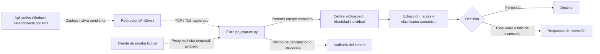

# Protección de la PC: preparación sin captura activa

## Estado de esta entrega

Se preparó un piloto de captura de red Windows por PID y se probó su **filtro** con tráfico HTTPS ficticio dirigido expresamente a un proxy temporal. No se probó la captura nativa de aplicaciones. No se activó WinDivert, no se instalaron certificados del sistema ni se cambiaron reglas de firewall. `npm start` mantiene su comportamiento anterior; no activa este módulo. Esto tampoco desactiva controles o extensiones instalados previamente.

**No hay control universal de la PC.** El programa rechaza `pc:start -- --all-apps` antes de inscribir equipos, escribir estado o abrir un driver. El modo estricto de las VM sigue siendo una restricción de salida al receptor del laboratorio, con un objetivo distinto al uso diario de Internet.

En la revisión local, `WinDivert64.sys` presentó firma Authenticode válida; `windows-redirector.exe` y `WinDivert.dll` presentaron `NotSigned`. El coordinador exige firma válida en los tres y bloquea el piloto mientras no se resuelva su procedencia/verificación. No se ha eliminado esa comprobación ni ejecutado esos componentes. El reporte es una observación de los archivos instalados, no una certificación de seguridad.

## Flujo diseñado y partes ejecutadas



La captura local de mitmproxy usa WinDivert en Windows. Puede seleccionar un proceso; eso no incluye automáticamente procesos secundarios, otras sesiones, VM o WSL. La inspección HTTPS requiere confianza en la CA del proxy. El cifrado propio de la aplicación puede dejar contenido opaco aun después de interceptar TLS; el pinning puede impedir establecer la conexión. En estos casos no se debe afirmar que Groq leyó el archivo.

El modo por PID es una herramienta de laboratorio, no una política que obliga a todas las aplicaciones a pasar por el DLP. Al terminar mitmproxy, la red normal puede continuar: **no existe un kill switch independiente**. Tampoco existe un minifilter de archivos que impida cualquier copia local antes de escribirla. No hay resistencia demostrada contra administradores, cambios de ruta, reinicios o evasiones.

## Qué hace el filtro nuevo

- Retiene el cuerpo HTTP antes de enviarlo al destino; no permite streaming de cargas ni exclusiones `ignore_hosts`.
- Inspecciona cuerpo, parámetros de consulta y ruta; conserva el origen del destino sin los valores de la consulta. Cookies y `Authorization` no se envían al clasificador. Los canales encubiertos en cabeceras no están resueltos.
- Usa credenciales individuales de inspección y telemetría. El proceso Python no recibe la clave Groq ni el token ADMIN.
- El central aplica `enforce` para esta ruta aunque la política general de `web_proxy` esté en `audit`. Conserva las listas de destinos y los umbrales: indicadores de bajo puntaje pueden producir alerta y permitir, según la política.
- Retiene cargas parciales, WebSocket, DNS sobre HTTPS con tipo `application/dns-message`, protocolos no admitidos y contenido que no pueda inspeccionarse completamente. Los manejadores TCP/UDP/DNS deniegan el canal capturado; sus pruebas unitarias no acreditan bloqueo nativo en Windows.
- Confirma por recibo la cancelación o la respuesta del destino. Una decisión de permitir no equivale por sí sola a entrega del archivo.
- Informa expresamente `universalProtection: false` y `failClosedOnProcessExit: false`. Los estados antiguos o de otra sesión no se aceptan como captura activa.

El límite de contenido es 10 MiB y 20 partes. Un archivo cifrado no se descifra: se retiene por no inspección. Una carga pública válida o vacía no se bloquea por ser simplemente un archivo.

## Groq y datos reales

El LLM existente se ejecuta en el central, según su `.env`; el filtro le entrega contenido a través de `/v1/inspect`. Solo analiza lo que alcanza ese flujo y puede extraerse dentro de sus límites. No observa por sí mismo la pantalla, todos los documentos abiertos ni las lecturas/escrituras del sistema.

La preparación y las pruebas de esta entrega no llaman a Groq: `groqLiveTested` es `false`. La prueba usa reglas locales para aislar la verificación de transporte. Las pruebas del cliente semántico usan respuestas simuladas y tampoco demuestran el funcionamiento de una clave real. En modo híbrido, texto real inspeccionado puede salir al proveedor; por eso no se activó captura en la PC de uso diario.

## Comandos disponibles ahora

Desde la carpeta del proyecto:

```powershell
npm.cmd run pc:prepare
npm.cmd run pc:plan
npm.cmd run pc:status
```

`prepare` crea únicamente `datos-endpoint/captura-pc/perfil.json` y preserva uno existente. No inscribe la PC, no genera una CA ni cambia `.env`. `plan` y `status` leen estado, firmas y permisos; no cargan el driver. El resultado esperado en esta entrega es `captureState: NOT_ACTIVE`, `allAppsReady: false`.

Para repetir las pruebas ficticias, con el entorno Python y dependencias del proyecto instalados:

```powershell
npm.cmd test
.\.venv\Scripts\python.exe -m unittest test.test_pc_capture test.test_integrations
npm.cmd run test:pc-filter
```

El último comando crea una CA temporal que solo confían los clientes de prueba; no la importa en Windows. Levanta servicios temporales en `127.0.0.1`, los cierra al terminar y escribe `output/evaluacion/resultado-captura-pc-filtro.json`. No requiere detener el central existente. No modifica su política ni sus identidades: usa un central temporal con tokens nuevos y muestras ficticias.

## Piloto futuro, todavía sin validar

Existe un coordinador para `pc:start -- --pid NUMERO --ack-data-processing`, ejecutado en primer plano con administrador y aceptación explícita del procesamiento. Ese comando **no se ejecutó en esta entrega**. Exige perfil del mismo host, binarios con firmas válidas y un central actualizado que anuncie `capabilities.pcCaptureEnforce`. Sin esas condiciones no abre el driver. Las versiones anteriores del central deben actualizarse antes del piloto; no se redeplegó el backend WSL durante esta preparación.

El primer arranque futuro de mitmproxy puede generar una CA privada en `datos-endpoint/captura-pc/ca-private`. El coordinador no instala su confianza en Windows; esa etapa necesita diseño y validación aparte. Cerrar el coordinador termina su propio proceso hijo. `npm.cmd run pc:stop` solicita su parada por una sesión identificada; no mata procesos ajenos por número PID. No modifica ni revierte reglas de otros perfiles.

No se configura inicio automático para esta captura, ni se oculta su instalación. Mantener un servicio en segundo plano no demuestra control de salida obligatorio.

## Cobertura de los doce casos

| Caso | Implementación disponible | Evidencia de esta entrega y límite |
|---|---|---|
| CU-01 USB | Operación mediada; política Windows de escritura USB separada | Sin nueva prueba USB. El bloqueo general del canal no es selección por contenido de toda copia nativa. |
| CU-02 copia local | Vigilante y correlación por hash | Regresión automatizada; detecta después de copiar. Falta prevención nativa selectiva. |
| CU-03 adjunto de correo | Filtro SMTP/MIME | XLSX público permitido y sensible retenido ante receptor SMTP independiente. No valida todas las aplicaciones de correo. |
| CU-04 cuerpo de correo | Filtro SMTP/MIME | Público permitido, sensible retenido, fallo del motor retenido. No es SMTP transparente de toda la PC. |
| CU-05 subida HTTPS | Motor y filtro de red preparado | XLSX y DOCX renombrado probados mediante proxy explícito. Captura nativa de navegadores/convertidores pendiente. |
| CU-06 texto web | Cuerpo, consulta y ruta HTTP | Pruebas HTTPS reales al receptor. WhatsApp/Discord nativos y cifrado de aplicación pendientes. |
| CU-07 rclone | WebDAV mediante proxy | Público entregado y sensible rechazado si el binario rclone está disponible; otros backends no validados. |
| CU-08 SFTP/SCP | Restricción del canal, no lectura de SSH | Manejador de denegación probado de forma unitaria; ninguna nueva prueba nativa SSH. |
| CU-09 FTP | Detección Suricata separada / restricción de canal | No hay filtro transparente FTP selectivo nuevo. |
| CU-10 DNS | Restricción DNS del laboratorio; denegar DNS capturado en piloto | Sin validación DNS nativa de uso diario. No hay nueva ejecución de túneles. |
| CU-11 cifrado | Retención si no se puede inspeccionar | Contenedor ZIP opaco retenido; no se acredita descifrado ni clasificación de su interior. |
| CU-12 evasión | Firma de formato, decodificación base64 y rechazo de fragmentos | Pruebas de DOCX renombrado, base64 y Content-Range. No cubre cualquier transformación o fragmentación arbitraria. |

Veinte pruebas de transporte no equivalen a sensibilidad/precisión del clasificador en una empresa. Falta un corpus independiente etiquetado para medir FP/FN con Groq real, por tipo de archivo y caso de uso; no se publican métricas nuevas inventadas.

## Trabajo necesario antes de uso diario

1. Resolver verificación de los componentes nativos y validar captura en una VM Windows con snapshot, por aplicación/proceso hijo/protocolo.
2. Diseñar una salida obligatoria con kill switch independiente y recuperación controlada, DNS funcional y cierre de rutas alternativas IPv4/IPv6/QUIC/VM/WSL. El backend en la misma PC necesita una frontera de confianza explícita; un proceso exento puede convertirse en ruta de salida.
3. Validar CA, aplicaciones con pinning/cifrado propio, autenticación, latencia, cortes y políticas para contenido no inspeccionable. No basta bloquear todas las aplicaciones para afirmar DLP selectivo.
4. Implementar o integrar controles nativos para archivos, USB, impresión y portapapeles según el caso. Un proxy no sustituye un minifilter.
5. Medir FP/FN y funcionamiento de Groq con documentos ficticios representativos antes de autorizar contenido real; probar caída del servicio, reinicio y restauración de conectividad.

## Referencias técnicas

- [mitmproxy: modos y captura local](https://docs.mitmproxy.org/stable/concepts/modes/).
- [mitmproxy: captura local en Windows y WinDivert](https://www.mitmproxy.org/posts/local-capture/windows/).
- [mitmproxy: protocolos y limitaciones](https://docs.mitmproxy.org/stable/concepts/protocols/).
- [mitmproxy: streaming y otras funciones](https://docs.mitmproxy.org/stable/overview/features/).
- [Microsoft: API Endpoint DLP](https://learn.microsoft.com/en-us/windows/win32/lwef/endpointdlp-endpoint-data-loss-prevention).

La arquitectura se inspira en separación entre inspección, decisión y aplicación de política; no acredita equivalencia con un producto comercial.
